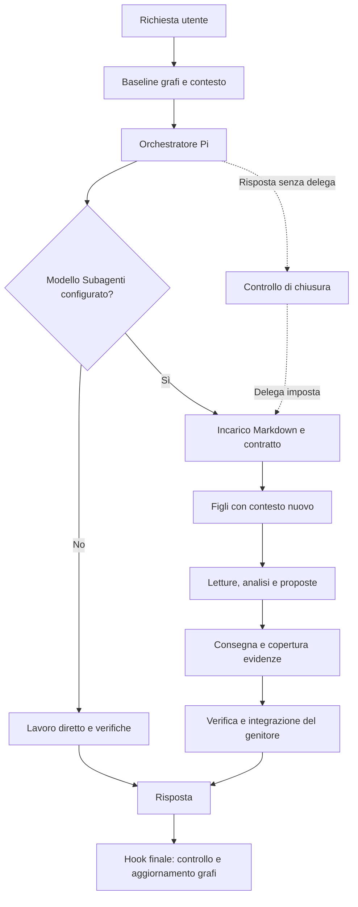
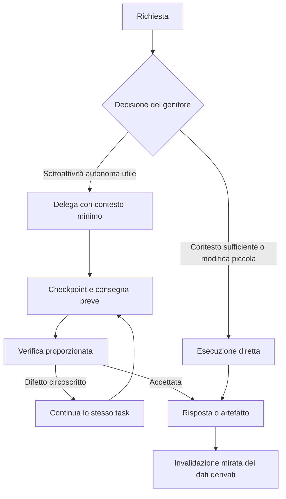

# Valutazione di contesto, orchestrazione e flussi — Pi Suite

Data: 2 novembre 2026. Repository analizzato: `edd450060b64a451a79e94258e884d7200ff0d5e`, versione dichiarata nel package: 0.6.5.

## Valutazione principale

Il comportamento segnalato ha una spiegazione concreta nel codice: **la configurazione di un modello Subagenti attiva una delega obbligatoria per ogni richiesta**, anche semplice. Se il genitore ha già preparato la risposta, il controllo di chiusura può riaprire il turno per obbligarlo a delegare. Questo trasforma una risposta pronta in una sequenza aggiuntiva di incarico, esecuzione, verifica e risposta.

Il sistema ha buone basi per analisi documentali verificabili: corpus versionati, strumenti con perimetro, proposte separate, citazioni controllate e registrazione della copertura. La politica di esecuzione applica però lo stesso costo organizzativo anche alle richieste che non ne beneficiano.

**Il milione di token non dimostra un contesto di un milione né un milione di token di risposta.** Il terminale Pi mostra separatamente consumo cumulativo e occupazione del contesto. Senza la traccia della prova non è possibile attribuire quel valore a una specifica voce. I meccanismi trovati spiegano bene un consumo cumulativo elevato, soprattutto in input.

La priorità è introdurre delega selettiva, limiti sulle dimensioni delle letture e dei risultati, continuità delle correzioni e telemetria per richiesta. Aumentare parallelismo o scegliere modelli diversi prima di questi interventi rischia di aumentare il consumo senza risolvere il flusso.

## Ambito ed evidenze

Ho esaminato launcher, estensioni Pi, contratto delle deleghe, strumenti di lettura, corpus e grafi, adapter del modello, metriche benchmark e punti principali del pannello. Ho inoltre letto le implementazioni installate di Pi e pi-subagents, svolto controlli locali senza chiamare modelli e consultato la documentazione ufficiale dei prodotti confrontati.

La copia installata individuata è in `C:/Users/andrea/AppData/Local/PiSuite`. Fra sei file centrali confrontati, `suite-delegation.ts`, `evidence-tools.mjs`, `suite_refresh_graphs.py` e `suite.py` coincidono con il repository; `suite-extension.ts` e `delegation-core.mjs` differiscono per le nuove istruzioni sulle fonti esterne. Non ho aggiornato l'installazione.

Nell'area `data/sessions` di questa installazione non ho trovato transcript JSONL e in `data/delegations` non ho trovato batch. Ciò non esclude sessioni in un'altra installazione o area dati. Non sono quindi disponibili misure reali di latenza, uso della cache, ripetizioni o errori delle prove segnalate. Le conclusioni distinguono comportamenti verificati, rischi derivati dal flusso e ottimizzazioni da misurare.

## Cosa significa il contatore token

Nel [footer del runtime installato](<C:/Users/andrea/AppData/Local/PiSuite/app/node_modules/@earendil-works/pi-coding-agent/dist/modes/interactive/components/footer.js:96>):

| Indicatore | Significato |
|---|---|
| `↑` | Input cumulativo registrato nella sessione |
| `↓` | Output cumulativo registrato nella sessione |
| `R` / `W` | Token di lettura/scrittura cache registrati |
| `CH` | Percentuale di cache hit dell'ultimo prompt osservato |
| `percentuale / finestra` | Occupazione del contesto e capacità del modello |

Il totale attraversa anche le compattazioni. Il denominatore della percentuale è una capacità, non un consumo. L'output conteggiato non equivale necessariamente al solo testo visibile: comprende quanto il provider/runtime attribuisce a quella categoria, incluse chiamate agli strumenti ed eventualmente reasoning.

Esempio aritmetico, **non misura delle tue prove**: 25 richieste con 40.000 token medi di input totalizzano 1.000.000 di token processati, pur mantenendo un contesto per richiesta molto inferiore. Con cronologia crescente, il costo delle riletture può aumentare rapidamente: per N chiamate e crescita media Δ, l'input cumulativo è approssimativamente `N × contesto_iniziale + Δ × N × (N−1) / 2`, prima degli effetti della compattazione.

I token in cache vanno trattati secondo la semantica del provider. Non si deve sommare una metrica che li include già con un'altra che li ripete. Analogamente, una misura del genitore non è automaticamente il totale dei figli.

La suite conserva `result.usage` dei figli nei risultati, ma restituisce questi dati al genitore come JSON testuale. Non espone qui un aggregato strutturato `usage` del tool che il footer possa sommare direttamente. Il pacchetto offre già input, output, cache, durata, turni e chiamate: il problema è soprattutto collegarli in modo coerente alla richiesta utente. Vedi [risultato della delega](<C:/Users/andrea/Desktop/vibe coding/pi-suite/suite-delegation.ts:92>) e [contratto upstream](<C:/Users/andrea/AppData/Local/PiSuite/app/node_modules/pi-subagents/src/api/delegation.d.ts:81>).

## Architettura e flusso attuale

Il launcher crea una configurazione distinta per la chat. Il genitore conserva la conversazione e ha i normali strumenti Pi. Ogni incarico crea una directory con `INCARICO.md`, `contract.json`, risultati e proposte. I figli hanno strumenti dedicati, non shell o rete, non possono creare altri figli e partono con `context: fresh`. Non ricevono automaticamente tutta la conversazione del genitore. Vedi [launcher](<C:/Users/andrea/Desktop/vibe coding/pi-suite/suite_cli.py:34>), [registrazione del figlio](<C:/Users/andrea/Desktop/vibe coding/pi-suite/suite-delegation.ts:26>) e [preparazione del batch](<C:/Users/andrea/Desktop/vibe coding/pi-suite/delegation-core.mjs:76>).

Il corpus selezionato viene fissato e i documenti sono consultati tramite strumenti. **Non ho trovato un caricamento automatico di tutto il corpus nel prompt di ogni figlio.** I manifest sono copiati nel contratto su disco e trasmessi al processo Python degli strumenti: questo crea costi di I/O e serializzazione, distinti dai token. Il prompt cresce soprattutto quando il modello apre documenti o riceve risultati estesi.

## Colli di bottiglia e sprechi

### 1. Delega obbligatoria e riapertura della risposta — priorità massima

**Verificato.** [suite-delegation.ts:39](<C:/Users/andrea/Desktop/vibe coding/pi-suite/suite-delegation.ts:39>) riapre una conclusione senza delega quando può ancora avviare un figlio. Il prompt alla riga 57 impone la delega anche per richieste semplici. La stessa politica è ripetuta nella [skill task-planner](<C:/Users/andrea/Desktop/vibe coding/pi-suite/skills/task-planner/SKILL.md:6>).

Effetto: quando l'orchestratore ha già risolto il problema, il figlio viene coinvolto troppo tardi e ricomincia un lavoro già sostanzialmente svolto. La latenza minima incorpora preparazione dell'incarico, chiamata al figlio e successiva sintesi del genitore.

**Intervento:** separare modello disponibile e politica di delega. Introdurre `off`, `auto`, `required`; usare `required` solo per workflow che lo richiedono realmente, ad esempio una produzione documentale per unità assegnate o una prova esplicitamente multiagente. In `auto`, una risposta sufficiente deve poter chiudere il turno. La scelta deve avvenire nel normale ragionamento dell'orchestratore, senza aggiungere un'altra chiamata LLM obbligatoria per classificare ogni richiesta.

### 2. Letture locali troppo grandi e ricerca insufficiente — priorità massima

**Verificato.** [read_source](<C:/Users/andrea/Desktop/vibe coding/pi-suite/delegation-core.mjs:115>) restituisce l'intero file fino a 200 KB: non accetta righe, offset o query. `list_sources` elenca una sola directory e i figli non hanno un equivalente di `rg` per il progetto vivo. La ricerca nelle fonti collegate non sostituisce sempre la ricerca nella working directory.

Nella prova locale `readText` ha restituito 64.503 caratteri per `suite.py`, 50.501 per `suite-ui/app.js` e 39.879 per `suite_evidence.py`. Una domanda su poche righe può dunque portare decine di migliaia di caratteri nel risultato del tool.

Per [read_evidence](<C:/Users/andrea/Desktop/vibe coding/pi-suite/suite_evidence.py:427>), il tetto predefinito è 100.000 caratteri e quello massimo 200.000; la quantità effettiva dipende dalla selezione. [read_documentation](<C:/Users/andrea/Desktop/vibe coding/pi-suite/chat-context.mjs:23>) limita le righe, non i caratteri: un file con una riga molto lunga elude la protezione. Una prova sintetica con una sola riga da 1.000.000 di caratteri e `limit: 1` ha prodotto **1.000.196 caratteri nel risultato del tool della suite**, prima di eventuali protezioni successive del runtime.

**Intervento:** ricerca testuale locale delimitata, lettura per intervallo e limite in caratteri/token applicato a tutti i tool. Proposta iniziale da calibrare: 8–16 KB per lettura, con espansione esplicita e paginazione per caratteri anche dentro una riga. Consentire ancora letture integrali quando servono, senza farne l'unica opzione.

### 3. Ogni correzione riparte da un nuovo contesto — priorità alta

**Verificato.** Ogni chiamata costruisce un nuovo batch e avvia un figlio `fresh`; `delegate_tasks` non offre un parametro di continuazione. Il prompt chiede correzioni mirate, ma il trasporto non continua il figlio precedente. Il genitore deve ripassare risultati e decisioni; quanto omette va ricostruito.

**Intervento:** aggiungere un percorso di continuazione, se supportato dall'integrazione scelta, oppure un checkpoint strutturato con risultato precedente, evidenze già verificate, file/hash e soli difetti residui. Non sostituire indiscriminatamente `fresh` con la copia dell'intera chat: farebbe crescere tutti i figli. Il riuso deve riguardare lo stesso compito e rispettare la versione del corpus.

### 4. Scansioni e aggiornamenti dei grafi nel ciclo della chat — priorità alta

**Verificato.** [suite-extension.ts:43](<C:/Users/andrea/Desktop/vibe coding/pi-suite/suite-extension.ts:43>) attende un processo Python di baseline prima del turno; l'hook `agent_end` avvia un altro aggiornamento. [suite_refresh_graphs.py:18](<C:/Users/andrea/Desktop/vibe coding/pi-suite/suite_refresh_graphs.py:18>) calcola `fingerprint(scan(root))`, anche prima del controllo che esce quando non ci sono grafi.

La scansione legge e calcola hash sui file ammessi; non riguarda soltanto sorgenti supportati dal parser AST. Se cambia il fingerprint, il refresh percorre l'inventario dei grafi consultabili del progetto, non soltanto quelli selezionati dalla chat. Può sincronizzare fonti, finalizzare documentazione e ricostruire grafi documentali. Quest'ultimo percorso può chiamare un modello nei passaggi non riutilizzati dalla cache. Non è corretto affermare che ogni turno rigeneri tutto: il codice ha controlli e cache.

Sul repository esaminato: 82 file, 960.244 byte testuali; tre esecuzioni di `scan + fingerprint` hanno richiesto 790,93 / 99,09 / 98,75 ms. È una misura locale limitata, senza avvio Python, caricamento dell'app e rigenerazione. Non dimostra minuti di ritardo, ma dimostra lavoro ripetuto indipendente dall'inferenza.

**Intervento:** uscire prima della scansione se non vi sono dipendenze da aggiornare; mantenere un insieme di file cambiati; invalidare solo grafi dipendenti; separare aggiornamento AST locale e ricostruzione semantica con LLM. Per la chat, mantenere stabile il corpus del compito e programmare aggiornamenti fuori dal suo percorso critico. Misurare separatamente il tempo prima del modello e quello dopo la risposta.

### 5. Limiti poco proporzionati al compito e attesa dell'intero batch — priorità alta

**Verificato.** Ogni figlio riceve 600 secondi e un budget di 64 tool; il genitore ha un watchdog di 630 secondi. Il numero predefinito di deleghe è 24 per sessione, con due worker paralleli e fino a quattro incarichi per batch. `Promise.all` restituisce il risultato del tool solo alla fine di tutti i worker. Gli aggiornamenti intermedi esistono, ma non equivalgono a una consegna utilizzabile dal genitore mentre gli altri proseguono. Vedi [esecuzione](<C:/Users/andrea/Desktop/vibe coding/pi-suite/suite-delegation.ts:71>) e [default](<C:/Users/andrea/Desktop/vibe coding/pi-suite/suite.py:124>).

Un task semplice può attendere un limite concepito per attività molto più lunghe. Un figlio lento può trattenere anche risultati già pronti. Esaurire `maxCalls` compromette richieste successive della stessa sessione, pur trattandosi di nuove richieste utente.

**Intervento:** budget separati per richiesta e sessione, scadenze proporzionate, restituzione parziale, checkpoint e rilevamento di stallo. Considerare progresso utile, non solo tempo: stesse letture ripetute, stesso errore o nessun nuovo artefatto. Non ho prove che il tuo caso sia un deadlock: può trattarsi di inferenza lenta, esplorazione ripetuta, errore o attesa fino al watchdog.

### 6. Risultati e copertura troppo estesi nel contesto del genitore — priorità alta

**Verificato.** La suite serializza risposta completa e `evidenceReading` nel risultato di `delegate_tasks`. La copertura contiene documenti, intervalli, selezioni, perimetro e dichiarazione. [report_evidence_reading](<C:/Users/andrea/Desktop/vibe coding/pi-suite/evidence-reading.mjs:155>) restituisce a sua volta una copertura estesa al figlio. Il pacchetto upstream limita la consegna testuale a 1 MiB, un tetto tecnico molto superiore a una sintesi operativa.

Non viene inoltrato l'intero transcript del figlio: l'isolamento esiste. Tuttavia il risultato finale e i metadati possono ancora occupare molto contesto, soprattutto su più incarichi.

**Intervento:** consegna strutturata breve con esito, risposta, riferimenti alle proposte, poche evidenze decisive, controlli e dubbi. Conservare la copertura completa su disco e aprirla su richiesta. Un tetto iniziale di 1–2 mila token per la sintesi è una scelta da sperimentare; documenti lunghi vanno consegnati come artefatti, non duplicati nella risposta del tool.

### 7. Compattazione presente, ma non una politica economica della suite — priorità alta

La chat ordinaria eredita la compattazione di Pi. Nel runtime installato è abilitata per default; `shouldCompact` confronta il contesto con `contextWindow - reserveTokens`, con riserva predefinita di 16.384 token e 20.000 token recenti da conservare. Vedi [impostazioni](<C:/Users/andrea/AppData/Local/PiSuite/app/node_modules/@earendil-works/pi-coding-agent/dist/core/settings-manager.js:597>) e [soglia](<C:/Users/andrea/AppData/Local/PiSuite/app/node_modules/@earendil-works/pi-coding-agent/dist/core/compaction/compaction.js:173>).

È una protezione dalla saturazione, non un obiettivo di latenza o spesa: una finestra molto grande può lasciare crescere la cronologia molto prima di intervenire. La configurazione della suite non introduce qui una soglia economica per tipo di task.

Distinzione importante: [adapter.mjs:59](<C:/Users/andrea/Desktop/vibe coding/pi-suite/adapter.mjs:59>) disabilita compattazione e retry, ma quel percorso serve probe e costruzione del grafo documentale. **Non è la configurazione della normale chat e non dimostra che i figli siano privi di compattazione.**

**Intervento:** stato sintetico del task, archiviazione dei risultati verbosi, soglie operative per modello e misure prima/dopo compattazione. Evitare riassunti LLM ad ogni turno: anche compattare costa. Preservare decisioni, riferimenti, difetti aperti e vincoli, con accesso agli originali.

### 8. Strumenti e capacità non allineati al ciclo di correzione — priorità media/alta

I figli possono proporre solo file interi autorizzati, fino a 200 KB, e non possono eseguire i test. Il genitore deve integrare e verificare. Questa separazione è utile per il controllo, ma una modifica minima a un file lungo genera l'intero file e una correzione può richiedere un altro ciclo di trasferimento.

**Intervento:** proposte come patch accompagnate dall'hash della versione di partenza e applicazione deterministica con verifica dei conflitti. Continuare sullo stesso task dopo gli errori di test. Se si desiderano worker esecutivi, introdurre strumenti di verifica specifici e un ambiente isolato; non ampliare genericamente i permessi per compensare un flusso inefficiente.

### 9. Overhead di processo, manifest e prompt — priorità media

Ogni consultazione tramite [invokeEvidence](<C:/Users/andrea/Desktop/vibe coding/pi-suite/evidence-tools.mjs:27>) avvia Python e invia il bundle completo. Ogni tool del figlio ricostruisce `scopedTools` e rilegge `contract.json`; le query grafo possono caricare e analizzare l'intero JSON. Con corpus grandi, questi costi si ripetono anche quando la risposta è piccola.

Le istruzioni di workflow sono presenti in più punti; alcune skill selezionate sono inserite integralmente nel prompt del genitore. Un incarico minimo di prova, rappresentato da 319 caratteri JSON, produce 2.780 caratteri Markdown senza regole AGENTS o perimetro documentale aggiuntivo. Non è una misura di token e non è da solo il problema principale, ma è un costo fisso per ogni figlio. Non ho dimostrato un'accumulazione infinita degli hook nel system prompt.

**Intervento:** cache di contratti immutabili e grafi per hash/versione, worker Python persistente o piccoli batch di letture, riferimenti ai manifest anziché copie ripetute, skill caricate per pertinenza. Tenere separati prefisso stabile e dati variabili. La cache del provider richiede compatibilità del prefisso e delle impostazioni: misurarla per modello, senza darla per garantita. [Documentazione OpenAI sul prompt caching](https://developers.openai.com/api/docs/guides/prompt-caching).

### 10. Telemetria, validazione delle consegne e riproducibilità — priorità alta

Il laboratorio benchmark richiede correttamente di dichiarare misure non disponibili e di separare orchestratore, figli e valutatore. Tuttavia il [resoconto delle metriche](<C:/Users/andrea/Desktop/vibe coding/pi-suite/RESOCONTO-METRICHE-PROVE.md:25>) chiarisce che l'importazione non raccoglie automaticamente la telemetria degli harness.

Il flag `delegated` diventa vero se almeno un figlio ha stato `completed`; il batch distingue comunque `needs_attention` se altri falliscono. La copertura mancante o obsoleta è esposta al genitore, ma la suite non traduce automaticamente tutti i criteri dell'incarico in una verifica deterministica. Un processo completato e una consegna accettata devono restare stati distinti.

Le copie installata e sorgente possono differire; inoltre ogni avvio usa un nuovo `agentDir` sotto `sessions`. Questo isola la configurazione, ma merita una gestione esplicita di elenco/ripresa delle chat fra avvii. Non basta avere transcript su disco per garantire continuità operativa.

**Intervento:** ledger locale degli eventi con `requestId`, `taskId`, `attemptId`, ruolo, modello, versione app, configurazione effettiva, tempi e usage. Distinguere esecuzione completata, proposta valida, risultato accettato e modifica applicata. Tenere errori, tentativi e lavori interni nel totale, evitando doppio conteggio fra eventi di progresso cumulativi e uso terminale.

## Confronto con ChatGPT Projects e Claude Code

Il confronto usa le capacità documentate, non ipotesi sugli internals proprietari di ChatGPT. Un progetto, una skill e un subagente rappresentano livelli differenti.

| Aspetto | Pi Suite attuale | ChatGPT Projects | Claude Code con subagenti |
|---|---|---|---|
| Unità principale | Chat Pi con estensioni e configurazione locale | Chat correlate con fonti e istruzioni condivise | Sessione principale con deleghe |
| Delega | Obbligatoria se esiste il profilo worker | Il progetto non specifica un obbligo di delega | Scelta secondo compito e contesto |
| Contesto del figlio | Sempre nuovo nel wrapper della suite | Non definito dal concetto di progetto | Contesto separato; possibilità di ripresa |
| Continuità | Il genitore riscrive l'incarico | Chat distinte conservano il proprio lavoro | Ripresa del figlio disponibile |
| Strumenti | Figli senza shell/rete, proposte separate | Dipendono dalla modalità e dagli strumenti disponibili | Configurabili per agente |
| Flusso | Attesa dell'intero batch | Il progetto organizza chat e fonti | Lavoro in foreground o background |
| Audit | Snapshot, copertura e citazioni espliciti | Non espone qui un contratto equivalente | Transcript e configurazione agenti |

ChatGPT Projects condivide file, istruzioni e fonti fra chat, mantenendo conversazioni distinte. Questo suggerisce per Pi Suite una memoria di progetto disponibile su richiesta e un contesto operativo limitato al compito corrente. La documentazione non consente di dedurre algoritmi interni di retrieval, token precisi o una particolare topologia multiagente. [Projects and chats](https://learn.chatgpt.com/docs/projects).

Claude Code raccomanda la conversazione principale per modifiche rapide, iterazioni con molto contesto comune e casi sensibili alla latenza; i subagenti isolano attività autonome o output voluminosi. Documenta ripresa e compattazione dei figli. Il vantaggio trasferibile è usare la delega quando evita più lavoro di quanto ne aggiunga. [Subagents](https://code.claude.com/docs/en/sub-agents).

Una skill contiene istruzioni, non costituisce da sola un agente. In Claude Code `context: fork` esegue una skill in un contesto isolato senza la storia della conversazione; la documentazione lo distingue dal fork della conversazione completa. Non va quindi equiparato automaticamente al valore `fork` di altri harness. Qui confronto la funzione ufficiale, non una specifica skill di terze parti non identificata. [Skills](https://code.claude.com/docs/en/skills).

Anche Claude Code paga le chiamate aggiuntive e il contesto dei worker: multiagente non significa automaticamente risparmio. La sua documentazione distingue caching, compattazione e riduzione del contesto; questi principi sono applicabili alla suite, ma non forniscono un rapporto di costo valido per i tuoi modelli. [Gestione dei costi](https://code.claude.com/docs/en/costs).

## Flusso consigliato

Il genitore mantiene obiettivo, decisioni, stato e collegamenti alle evidenze. Ogni figlio riceve solo ciò che serve per una responsabilità distinta. File originali, risultati estesi e coperture restano fuori dal prompt finché non necessari. Una revisione controlla soprattutto i punti modificati, i vincoli e le evidenze decisive, evitando di ripetere integralmente l'esplorazione.

Per modelli locali su un unico acceleratore, due worker simultanei possono competere per memoria e calcolo. È un'ipotesi da verificare sul backend effettivo, non un risultato di questa analisi. Confrontare concorrenza 1 e 2 prima di aumentarla a 4; misurare tempo totale, attese e qualità, non solo il numero di processi avviati.

## Interventi ordinati e criteri di successo

| Ordine | Modifica | Verifica di accettazione |
|---|---|---|
| 1 | `delegationPolicy`, aggiornando hook e skill insieme | Richieste semplici completabili con zero figli anche con worker configurato; workflow `required` preservati |
| 2 | Ledger di tempi e usage per richiesta | Totale riconciliabile con parent, figli, tentativi e grafi; dati mancanti espliciti |
| 3 | Ricerca locale, lettura per intervalli e tetto globale dei risultati | Anche una singola riga enorme viene paginata; citazioni e offset restano corretti |
| 4 | Consegne brevi e copertura esterna al prompt | Dettagli recuperabili senza serializzare tutta la copertura a ogni chiusura |
| 5 | Continuazione delle correzioni e checkpoint | La seconda iterazione riprende il lavoro e non ripete le letture già valide senza motivo |
| 6 | Grafi aggiornati per dipendenze e fuori dal percorso critico | Una domanda senza modifiche non rigenera grafi; una modifica irrilevante non avvia LLM semantici |
| 7 | Budget per task, risultati parziali e stallo | Un worker bloccato non trattiene indefinitamente gli esiti pronti |
| 8 | Patch, cache locali e ottimizzazione processi | Meno byte e avvii a parità di risultato verificato |

Nell'immediato, lasciare vuoto il profilo Subagenti attiva già la modalità diretta. È utile come controllo sperimentale, ma non sostituisce una politica `auto`: costringe oggi a una scelta globale fra sempre e mai.

## Piano di misurazione

Confrontare almeno tre configurazioni: A) suite attuale; B) solo orchestratore; C) delega selettiva con letture limitate. Usare stesso modello principale, effort, fonti e criteri di correttezza. Tenere separati confronto architetturale e confronto fra modelli.

Casi: risposta semplice già contestualizzata; ricerca di una funzione; modifica di poche righe in file lungo; analisi di documenti; dossier ampio; correzione di una proposta; timeout o errore controllato. Ripetere su chat nuove e lunghe e distinguere cache fredda/calda. Non imporre al modello testato di ricostruire misure che solo l'harness conosce.

Raccogliere:

- tempo dal messaggio al primo testo utile e alla risposta finale;
- tempo di preparazione, avvio worker, inferenza, tool, verifica e hook finali;
- input, output, cache e reasoning quando disponibile, con semantica documentata;
- massimo contesto per singola richiesta, distinto dalla somma della sessione;
- numero di figli, tentativi, compattazioni, chiamate agli strumenti e byte restituiti;
- intervalli letti più volte sulla stessa versione, distinguendo verifiche deliberate e duplicazioni evitabili;
- completamento accettato, errori, parti mancanti e qualità della risposta.

Per latenze confrontare mediana e distribuzione; usare percentili di coda solo con abbastanza prove. Non propongo percentuali di risparmio come fatti: senza esecuzioni rappresentative sarebbero inventate. L'obiettivo iniziale verificabile è eliminare deleghe obbligatorie inutili, grandi payload accidentali e riletture integrali nelle correzioni, mantenendo la qualità.

## Limiti e consegna

Questo è un audit statico con quattro verifiche locali: confronto delle copie, scansione del repository, dimensioni di incarichi/letture e riproduzione del risultato sproporzionato su una singola riga sintetica. Non è un benchmark end-to-end; non ho avviato modelli, installato dipendenze o cambiato il funzionamento dell'applicazione.

Gli elementi da preservare sono isolamento dei figli, divieto di delega ricorsiva, corpus versionati, proposte separate, controlli sulle citazioni e cache AST/semantica già presenti. Il cambiamento architetturale centrale consiste nel rendere questi meccanismi proporzionati al compito e osservabili, anziché applicare obbligatoriamente l'intero flusso a ogni messaggio.
